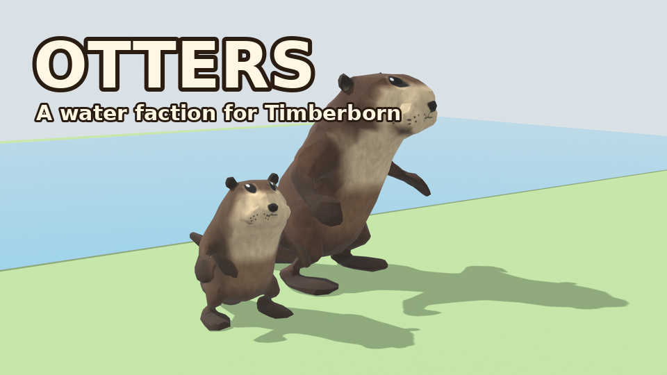
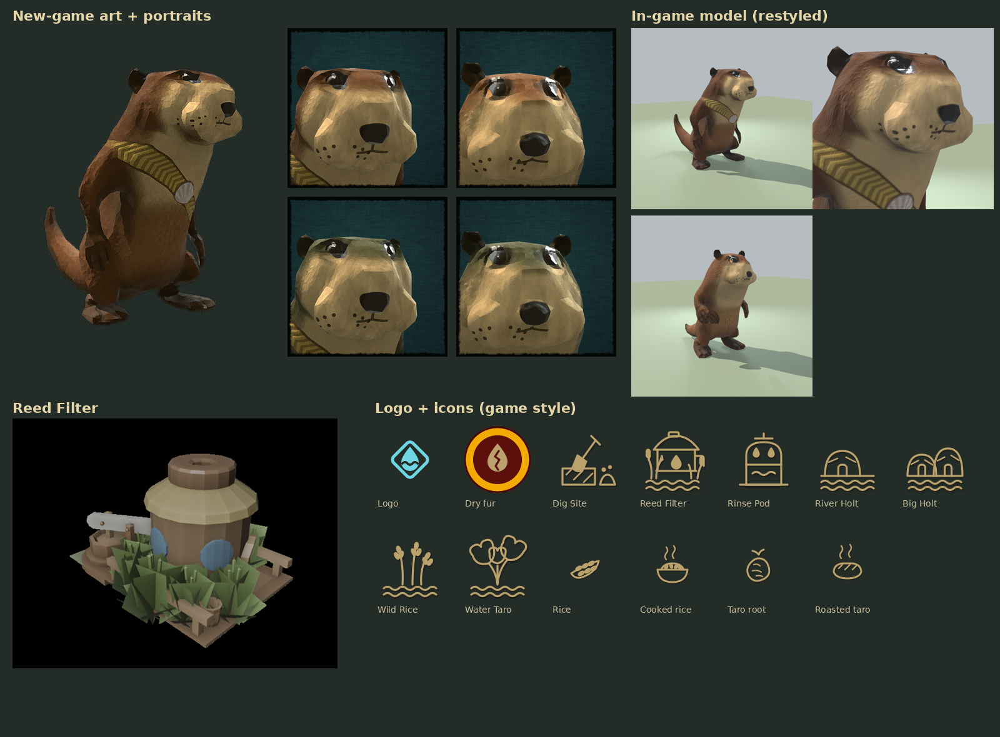

# Otters — a water faction for Timberborn



A third playable faction for **Timberborn 1.1.2+**: sleek river otters who would rather swim than walk.
They manage water from day one, farm aquatic crops faster, dig out terrain without explosives and filter
badwater clean — but they're slow on land and work slower once their fur dries out.

## Features

| | |
|---|---|
| **Water experts** | Levee, Floodgate, Aquatic Farmhouse and Shower need no science; bigger floodgates, valves, the Large Water Pump and the Lido are cheaper. |
| **Aquatic farming** | Cattail and Spadderdock grow ~40% faster. Two new aquatic crops, **Wild Rice** and **Water Taro**, cooked at the Grill into new foods. |
| **Mangroves** | Otters can plant Mangrove trees in water for logs and mangrove fruit. |
| **River Holts** | Otter dens that must stand in water (3 and 6 residents); residents' fur stays wet while they sleep. |
| **Dig Site** | From the start, free, no explosives: builders slowly dig out a block by paw and leave 1 dirt behind. Terrain Blocks (4 dirt) need no science. |
| **Reed Filter** | A Folktails water pump with reeds at its feet that turns badwater into clean water where it stands. |
| **On land / in water** | Walk ~15% slower than beavers, swim much faster. |
| **Moisture** | A new need. When it runs dry the otter gets *Dry fur* and works 15% slower. Swimming, the Shower, the Lido, the Domed Garden and River Holts refill it. |
| **Rinse Pod** | 550 science. Uses clean water to wash badwater contamination out of otters (no Herbalist/Antidote). |
| **Fishing Dock** | From the start: a fisher brings up fish from the water under the line; badwater spoils the catch. Fish are eaten raw or grilled at the Grill. |
| **Splash Pool** | From the start: a log-framed swimming hole set into the river. Fun for everyone, a big soak for otter fur. |
| **Artesian Well** | 600 science, 750 hp and an operator: pours clean water out of nowhere, even in badtides and (at half speed) droughts, over the edge behind it. Breaks down now and then and has to be repaired. |
| **Water Tubes** | The game's tube pieces carrying water: plug them into the well's walls and end them at a **Tube Outlet** to put the water anywhere. |
| **Smokehouse** | Fish into Smoked Fish, the otters' best food. |
| **Otter Slide** | A slide tower with a chute into the river: fun, and a big soak. |
| **Clean water** | Crops planted by otters grow 1.5x faster while their water is 100% clean. |
| **Co-op** | Works with Timber Together for shared colonies and all-otter separate colonies; see [docs/TIMBER-TOGETHER.md](docs/TIMBER-TOGETHER.md). |
| **Their own look** | Custom 3D adult and kit bodies with fur detail baked from the game's own beaver textures, a woven reed sash, 4 adult and 3 kit fur colours, every beaver animation carried over, game-style icons and a shell logo; faction art painted for the mod. |



*Motto: Clean water, warm dens, and a good swim.*

## Install

1. Download **Otters.zip** from the [latest release](../../releases/latest).
2. Unzip it into `Documents\Timberborn\Mods\` so you have `Mods\Otters\version-1.1\manifest.json`.
3. Start Timberborn, enable **Otters** under *Mods*, and pick the Otters faction in a new game.

The `mod` folder in this repository is the same mod **without the two otter body models**
(`*.timbermesh`, 100+ MB, over GitHub's file limit) — use the release zip to play.

## Repository layout

| Path | What it is |
|---|---|
| `src/` | C# code (`Otters.dll`): Dig Site, Reed Filter, River Holt placement, Fishing Dock catch, Artesian Well water, breakdowns and water tubes, clean-water crop growth, faster swimming, otter material maps. |
| `build_mod.py` | Generates every blueprint from the game's own vanilla blueprints; all balance numbers are at the top. |
| `art/make_art.py` | Vector art for icons, logo and fallback portraits. |
| `model/` | Building props (`procmesh.py`, `make_fishing_dock.py`, `make_splash_pool.py`, `make_reed_filter.py`, `make_props.py`) and the otter model pipeline (Python + Blender's `bpy`): shape, UVs, fur painting, animation transfer, `.timbermesh` export. See `model/README.txt`. |
| `tools/validate_blueprints.py` | Checks every blueprint against the game's spec schema. |
| `mod/Otters/` | Built mod (minus model files). |

## Building

```
# code
dotnet build src/Otters.csproj -c Release -p:GameManaged="<Timberborn>/Timberborn_Data/Managed" -o build

# blueprints (vanilla blueprints come from the game's StreamingAssets/Modding/Blueprints.zip)
python3 build_mod.py <vanilla blueprints> mod/Otters build/Otters.dll <model output folder>
python3 art/make_art.py mod/Otters/version-1.1 mod/Otters <model output folder>/portraits
```

The model pipeline needs the beaver bodies from your own copy of the game; see `model/README.txt`.
No game files are included in this repository.

## Status

Checked against the game's own blueprint merger, deserializer and model reader, but not yet widely
playtested. Issues and screenshots welcome.

*Fan-made mod; not affiliated with or endorsed by Mechanistry.*
